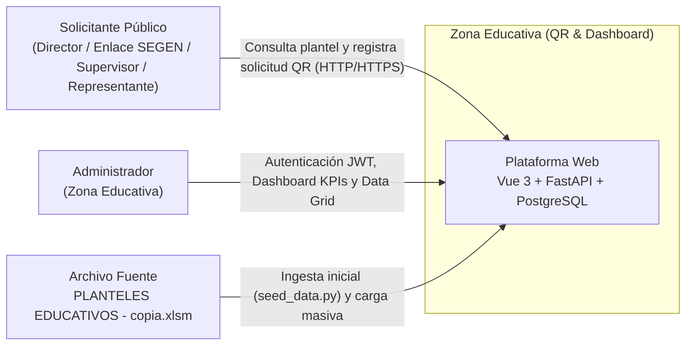
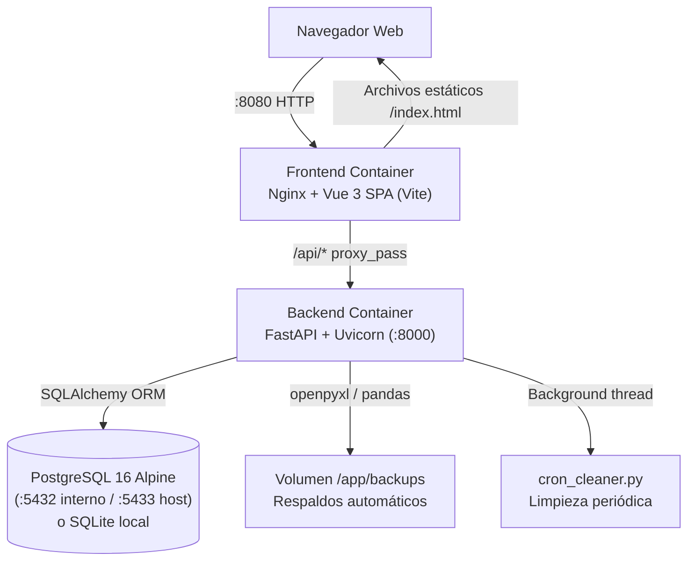
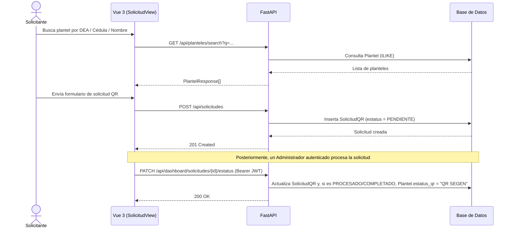
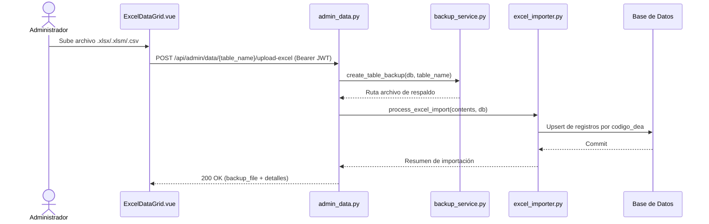

# Arquitectura del Sistema — Zona Educativa

Este documento detalla la arquitectura real de **Zona Educativa** mediante diagramas C4, flujos críticos, topología de despliegue y Registros de Decisiones de Arquitectura (ADRs). Complementa el documento raíz [`ARCHITECTURE.md`](../ARCHITECTURE.md).

---

## 1. Diagrama C4 — Nivel 1: Contexto del Sistema

---

## 2. Diagrama C4 — Nivel 2: Contenedores

---

## 3. Flujos Clave

### 3.1 Flujo de Solicitud Pública de QR y Aprobación

### 3.2 Flujo de Carga Masiva Excel con Respaldo Atómico

---

## 4. Topología de Despliegue (`docker-compose.yml`)

| Servicio | Contenedor | Imagen / Build | Puertos (Host:Contenedor) | Persistencia |
| :--- | :--- | :--- | :--- | :--- |
| `db` | `zona_educativa_db` | `postgres:16-alpine` | `5433:5432` | Volumen `postgres_data` |
| `backend` | `zona_educativa_backend` | `./backend/Dockerfile` | `8000:8000` | Bind `./backend:/app` + `.xlsm` |
| `frontend` | `zona_educativa_frontend` | `./frontend/Dockerfile` | `8080:80` | Bind `./frontend/dist` y `nginx.conf` |

- **Arranque del backend:** `python app/seed_data.py && uvicorn app.main:app --host 0.0.0.0 --port 8000` tras verificar `service_healthy` en `db`.
- **Proxy inverso:** `frontend/nginx.conf` sirve la SPA con `try_files $uri $uri/ /index.html` y redirige `/api/` a `http://backend:8000/api/`.

---

## 5. Registros de Decisiones de Arquitectura (ADRs)

### ADR-001: FastAPI + SQLAlchemy 2.0 con doble soporte PostgreSQL / SQLite
- **Contexto:** Se requiere una API rápida con validación tipada y facilidad de pruebas locales sin depender de un servidor PostgreSQL en cada estación.
- **Decisión:** Usar FastAPI, Pydantic v2 y SQLAlchemy leyendo `DATABASE_URL` con fallback a `sqlite:///./zona_educativa.db` (`backend/app/database.py`).
- **Consecuencias:** Permite ejecutar pruebas y desarrollo local rápidamente, manteniendo PostgreSQL 16 en Docker/producción.

### ADR-002: Vue 3 (Composition API) + Pinia + AG Grid
- **Contexto:** El panel administrativo necesita manipular ~988 planteles con edición por celda, filtros y exportación/importación.
- **Decisión:** Adoptar Vue 3 `<script setup>`, Pinia para estado global (`stores/`), composables reutilizables (`composables/`) y `ag-grid-vue3` para la vista tabular.
- **Consecuencias:** Alta interactividad en el navegador y separación clara entre lógica de estado y presentación.

### ADR-003: Respaldo previo obligatorio en importaciones Excel
- **Contexto:** Una carga masiva defectuosa podría sobrescribir registros válidos de planteles.
- **Decisión:** Invocar `create_table_backup(db, table_name)` antes de ejecutar `process_excel_import` en `admin_data.py`. Si el respaldo falla, la importación se aborta con HTTP 500.
- **Consecuencias:** Protege la integridad histórica de los datos ante errores humanos durante cargas masivas.

