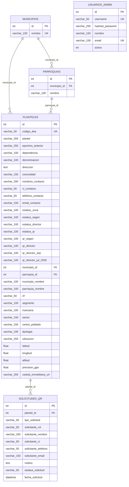

# Modelo de Base de Datos — Zona Educativa

Este documento refleja el esquema relacional real definido en [`backend/app/models.py`](../backend/app/models.py) con SQLAlchemy 2.0.

- **Motor en producción / Docker:** PostgreSQL 16 (`DATABASE_URL`)
- **Motor en desarrollo local / fallback:** SQLite (`sqlite:///./zona_educativa.db`)
- **Creación de tablas:** `Base.metadata.create_all(bind=engine)` en `backend/app/main.py`

---

## 1. Diagrama Entidad-Relación (ERD)

---

## 2. Diccionario de Tablas

### 2.1 `municipios` (`Municipio`)
| Columna | Tipo | Restricciones | Índice |
| :--- | :--- | :--- | :--- |
| `id` | `Integer` | `PK` | Sí |
| `nombre` | `String(100)` | `UNIQUE`, `NOT NULL` | Sí |

### 2.2 `parroquias` (`Parroquia`)
| Columna | Tipo | Restricciones | Índice |
| :--- | :--- | :--- | :--- |
| `id` | `Integer` | `PK` | Sí |
| `municipio_id` | `Integer` | `FK -> municipios.id`, `NOT NULL` | No |
| `nombre` | `String(100)` | `NOT NULL` | Sí |

### 2.3 `planteles` (`Plantel`)
| Grupo | Columnas Clave | Restricciones / Notas |
| :--- | :--- | :--- |
| **Identificación** | `id` (PK), `codigo_dea` (`String(50)`, `UNIQUE`, `NOT NULL`, index), `plantel` (`String(255)`, `NOT NULL`, index), `eponimo_anterior` | `codigo_dea` es la clave de negocio usada para búsquedas y upsert en ETL. |
| **Clasificación** | `dependencia` (`String(100)`, `NOT NULL`, index), `denominacion`, `direccion` (`Text`), `comunidad` | `dependencia` agrupa Nacional, Estadal, Privada, etc. |
| **Contacto** | `nombres_contacto`, `ci_contacto`, `telefono_contacto`, `email_contacto` | Usados en búsqueda pública y contacto de dirección. |
| **Estatus** | `estatus_zona`, `estatus_segen` (index), `estatus_director` (index), `estatus_qr` (`NOT NULL`, index) | Valores principales de `estatus_qr`: `QR SEGEN`, `SIN QR ASIGNADO`, `REPONER QR`. |
| **Códigos QR** | `qr_segen`, `qr_director`, `qr_director_sep`, `qr_director_jul_2026` | Códigos históricos y vigentes asociados al plantel. |
| **Ubicación** | `municipio_id` (FK), `parroquia_id` (FK), `municipio_nombre` (index), `parroquia_nombre` | Desnormalización controlada de nombres para consultas rápidas. |
| **Territorio y GPS** | `rif`, `segmento`, `manzana`, `sector`, `centro_poblado`, `tipologia`, `ubicacion`, `latitud`, `longitud`, `altitud`, `precision_gps`, `cedula_inmobiliaria_url` | Datos georreferenciados e inmobiliarios del plantel. |

### 2.4 `solicitudes_qr` (`SolicitudQR`)
| Columna | Tipo | Restricciones / Default | Índice |
| :--- | :--- | :--- | :--- |
| `id` | `Integer` | `PK` | Sí |
| `plantel_id` | `Integer` | `FK -> planteles.id`, `NOT NULL` | No |
| `tipo_solicitud` | `String(50)` | `NOT NULL` (`NUEVA_ASIGNACION`, `REPOSICION`, `CORRECCION`) | Sí |
| `solicitante_rol` | `String(50)` | `NOT NULL` (`DIRECTOR`, `ENLACE_SEGEN`, `SUPERVISOR`, `REPRESENTANTE`) | Sí |
| `solicitante_nombre` | `String(200)` | `NOT NULL` | No |
| `solicitante_ci` | `String(50)` | `NOT NULL` | No |
| `solicitante_telefono` | `String(50)` | `NOT NULL` | No |
| `solicitante_email` | `String(150)` | `NOT NULL` | No |
| `motivo` | `Text` | Nullable | No |
| `estatus_solicitud` | `String(50)` | Default `"PENDIENTE"` | Sí |
| `fecha_solicitud` | `DateTime` | Default `datetime.utcnow` | Sí |

### 2.5 `usuarios_admin` (`UsuarioAdmin`)
| Columna | Tipo | Restricciones / Default | Índice |
| :--- | :--- | :--- | :--- |
| `id` | `Integer` | `PK` | Sí |
| `username` | `String(50)` | `UNIQUE`, `NOT NULL` | Sí |
| `hashed_password` | `String(255)` | `NOT NULL` (hash `bcrypt`) | No |
| `nombre` | `String(150)` | `NOT NULL` | No |
| `email` | `String(150)` | `UNIQUE`, `NOT NULL` | No |
| `activo` | `Integer` | Default `1` (`1` activo, `0` inactivo) | No |

